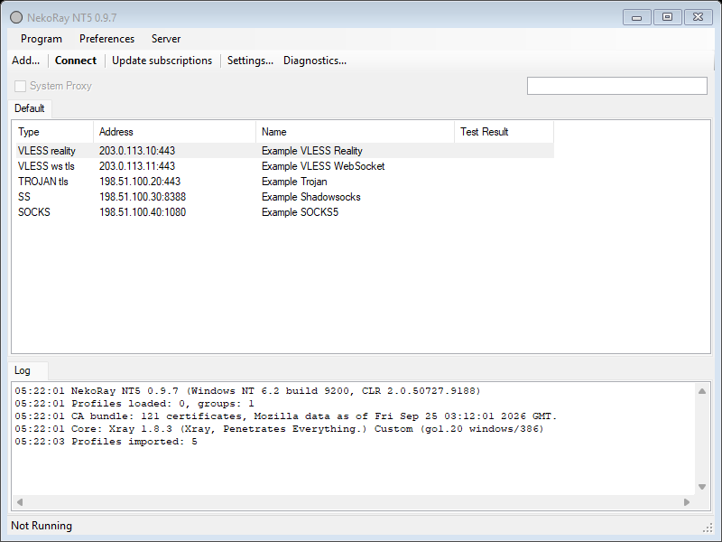
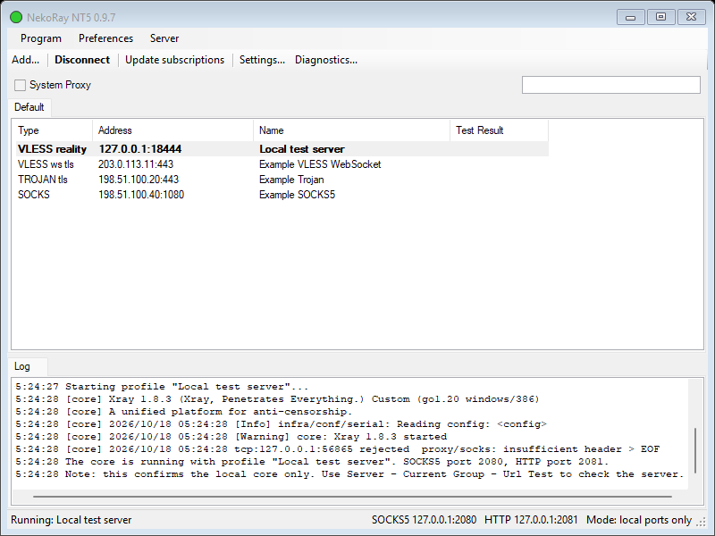
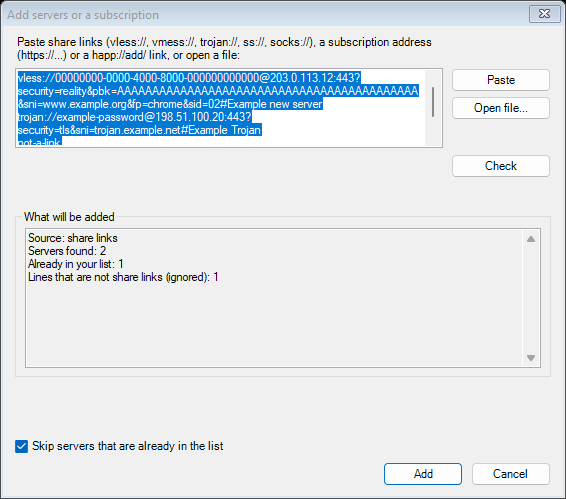
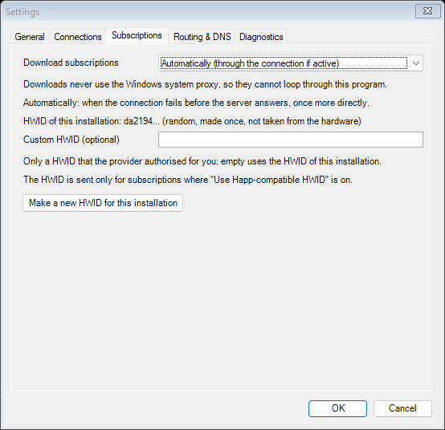
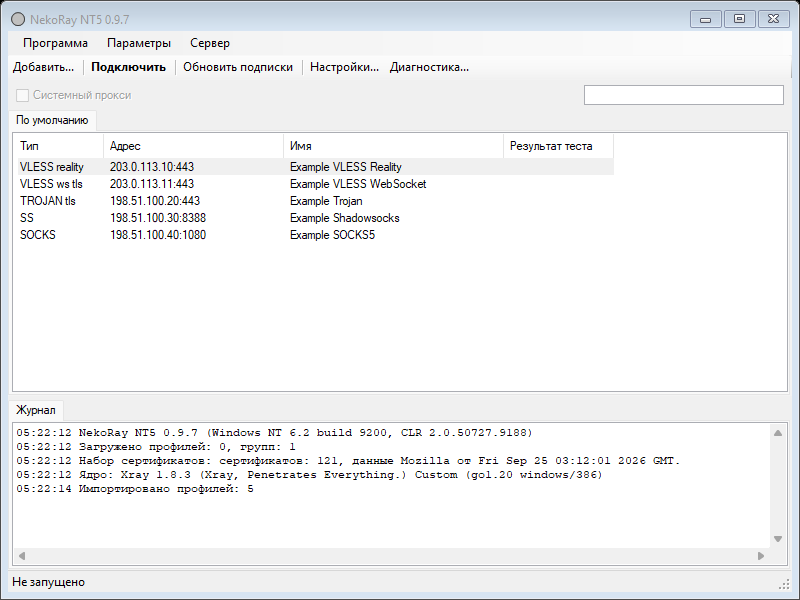
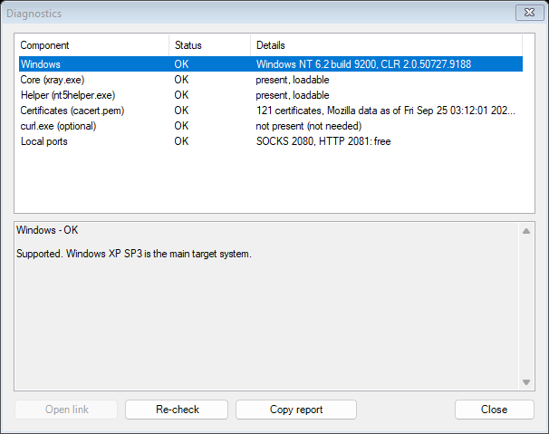
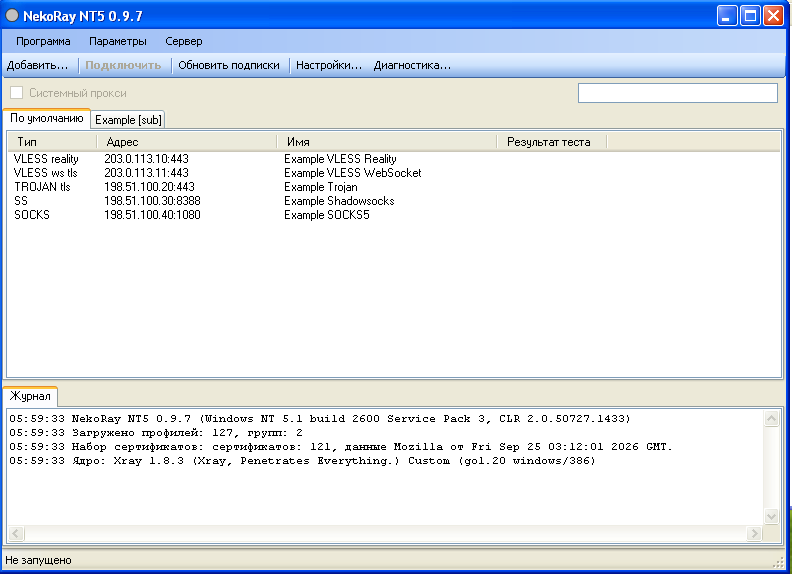
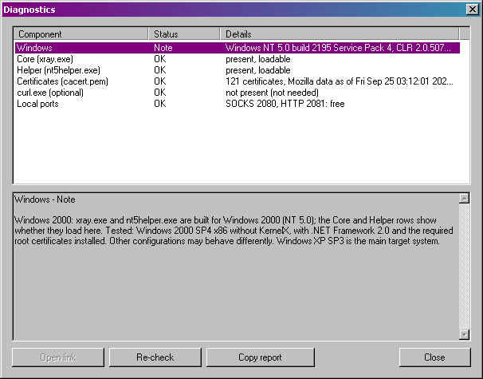

# NekoRay NT5

[English](README.md) | [Русский](README.ru.md)

Небольшой прокси-клиент для **Windows XP SP3** и **Windows 2000 SP4** (32-бит, x86): программа на
Windows Forms (.NET Framework 2.0), которая управляет серверами и подписками и запускает ядро
[Xray](https://github.com/XTLS/Xray-core) 1.8.3, собранное так, чтобы оно работало на этих системах.

NekoRay NT5 — независимая адаптация [NekoRay](https://github.com/MatsuriDayo/nekoray) (GPL-3.0) для
Windows NT 5.x, которую поддерживает сообщество. Устройство и настройки по умолчанию повторяют
NekoRay 3.17, но сама программа — отдельная реализация на C# 2.0, а работа по совместимости с
Windows 2000 / XP (пропатченный тулчейн Go, сборка Xray, помощник) относится только к этому проекту.
Это **не** официальный выпуск NekoRay, и сопровождающие NekoRay его не одобряли.

> **Статус: 0.9.7-dev1 — выпуск для разработки, не стабильная версия.** Что и где проверено — в
> разделе [Проверенные конфигурации](#проверенные-конфигурации).



*Главное окно с примерами серверов (документационные адреса, настоящих серверов нет). Галерея
возможностей на этой странице — шесть снимков настоящей программы, сделанных на сборочном
компьютере с Windows 11 с синтетическими данными; снимки с настоящих Windows XP SP3 и Windows 2000
SP4 — в разделе [Снимки экрана с Windows XP и Windows 2000](#снимки-экрана-с-windows-xp-и-windows-2000).*

## Содержание

- [Что делает программа](#что-делает-программа)
- [Возможности](#возможности)
- [Требования](#требования)
- [Проверенные конфигурации](#проверенные-конфигурации)
- [Загрузка и установка](#загрузка-и-установка)
- [Первый запуск и работа](#первый-запуск-и-работа)
- [Системный прокси](#системный-прокси)
- [Устранение неполадок](#устранение-неполадок)
- [Известные ограничения](#известные-ограничения)
- [Снимки экрана с Windows XP и Windows 2000](#снимки-экрана-с-windows-xp-и-windows-2000)
- [Сборка из исходного кода](#сборка-из-исходного-кода)
- [Лицензия и благодарности](#лицензия-и-благодарности)

## Что делает программа

**Добавить сервер или подписку -> выбрать сервер -> Connect -> при желании включить System Proxy ->
Disconnect.**

Интерфейс по умолчанию английский; русский включается в Settings -> General -> Language. Ниже
названия элементов даны по-английски, в скобках — как они называются в русском интерфейсе.

- **Connect** (**Подключить**) запускает Xray с выбранным сервером. Xray слушает только локальные
  порты: SOCKS5 `127.0.0.1:2080` и HTTP `127.0.0.1:2081` (меняются в настройках).
- **System Proxy** (**Системный прокси**) направляет настройки прокси Windows (WinINet) на
  локальный HTTP-порт, чтобы Internet Explorer и другие программы, использующие эти настройки,
  работали через подключение.
- **Disconnect** (**Отключить**) останавливает ядро и восстанавливает прежние настройки прокси.



*Состояние «подключено»: настоящая программа запускает Xray 1.8.3 с локальным тестовым сервером
VLESS + REALITY + Vision на 127.0.0.1 (синтетические ключи). System Proxy на сборочном компьютере
был выключен.*

## Возможности

- **Протоколы:** VLESS (в том числе REALITY и Vision), VMess, Trojan, Shadowsocks, SOCKS5;
  транспорты TCP, WebSocket, gRPC и HTTP/2 — в объёме, который поддерживает Xray 1.8.3.
- **Одна команда Add для всего:** ссылка (`vless://`, `vmess://`, `trojan://`, `ss://`,
  `socks://`), список ссылок (обычный, Base64 или URL-кодированный), файл, адрес подписки
  (`http://` или `https://`) или ссылка `happ://add/<address>`. Предпросмотр показывает найденные
  серверы, дубликаты и непригодные строки; до нажатия **Add** ничего не сохраняется.
- **Подписки:** профили при обновлении сохраняют стабильность и остаются прежними, если обновление
  не удалось; загрузка идёт автоматически, только через активное подключение или напрямую — но
  никогда через системный прокси Windows. Для каждой подписки можно включить Happ-совместимый HWID
  (случайный идентификатор, созданный для этой установки, или свой).
- **HTTPS с современным TLS на старой Windows:** подписки загружает встроенный помощник
  `nt5helper.exe` по TLS 1.2/1.3 с проверкой по встроенному списку корневых сертификатов Mozilla
  (`cacert.pem`). Проверка сертификатов никогда не отключается.
- **Группы, проверка задержки (URL Test), правила маршрутизации и DNS, резервная копия и
  восстановление, значок в области уведомлений.**
- **Английский и русский интерфейс** (Settings -> General -> Language).
- **Diagnostics** (**Диагностика**): проверяет файлы программы, сертификаты и порты, объясняет, чего
  не хватает, и копирует отчёт без адресов, идентификаторов, ключей и имён пользователей.





## Требования

**Для работы программы** (пользователям):

| Требование | Подробности |
|---|---|
| Операционная система | Windows XP SP3 x86 или Windows 2000 SP4 x86 |
| .NET Framework 2.0 | нужен на обеих системах |
| Процессор | с SSE2 (Pentium 4, Athlon 64 или новее): `xray.exe` и `nt5helper.exe` собраны с `GO386=sse2` |
| Корневые сертификаты | рекомендуются на обеих системах; в проверенной конфигурации Windows 2000 они были установлены. Собственная загрузка HTTPS-подписок программой использует встроенный `cacert.pem`; хранилище сертификатов Windows важно для браузеров и для необязательных запасных способов загрузки |

Для проверенных конфигураций ниже не нужны ни расширенное ядро (KernelX), ни другие расширения
системы. Windows Vista и новее не являются целевыми системами; там используйте официальный
NekoRay / NekoBox.

**Для сборки** (только разработчикам): см. [Сборка из исходного кода](#сборка-из-исходного-кода).

## Проверенные конфигурации

| Что | Где | Результат |
|---|---|---|
| Ссылки VLESS, HTTP-подписки, URL Test, подключение, отключение, переподключение, трафик браузера через прокси (0.9.7-dev1) | **Windows XP SP3 x86**, без расширений системы — ручная проверка сопровождающим | работает |
| То же (0.9.7-dev1) | **Windows 2000 SP4 x86, без KernelX**, с .NET Framework 2.0 и установленными нужными корневыми сертификатами — ручная проверка сопровождающим | работает |
| Release-сборка; self-test (351 проверка); UI smoke test (52 проверки, английский и русский); Go-тесты nt5helper; зонд рантайма Windows 2000; сквозной тест VLESS + REALITY + Vision | Сборочный компьютер с Windows 11 (пути Windows 2000 — в режиме имитации) | всё проходит — это **не** проверка на целевых системах |

Результат для Windows 2000 относится к описанной выше конфигурации. Другие установки Windows 2000
(без SP4, с другими обновлениями, на другом оборудовании) не проверялись и могут вести себя иначе.
Подробности: [docs/nt5-win2000.md](docs/nt5-win2000.md).

## Загрузка и установка

1. Скачайте `NekoRayNT5-v0.9.7-dev1-win32.zip` на странице
   [Releases](https://github.com/quargelk/NekoRay-NT5/releases).
2. При желании проверьте архив: на странице выпуска указан его SHA-256, а `SHA256SUMS.txt` внутри
   архива содержит суммы всех файлов.
3. Распакуйте всю папку в любое место, например `C:\Programs\NekoRayNT5`. Файлы должны лежать
   вместе:

   | Файл | Назначение |
   |---|---|
   | `NekoRayNT5.exe` | программа |
   | `xray.exe` | ядро (Xray 1.8.3, собранный для Windows 2000 / XP) — нужно для подключения |
   | `nt5helper.exe` | загрузка HTTPS-подписок с современным TLS |
   | `cacert.pem` | набор корневых сертификатов Mozilla для `nt5helper.exe` |
   | `README.txt` | краткая инструкция |
   | `licenses\` | лицензии всех компонентов (список — в `THIRD-PARTY.txt`) |

4. Установите .NET Framework 2.0, если его нет, и запустите `NekoRayNT5.exe`.

Установщика нет. Данные хранятся в `%APPDATA%\NekoRayNT5` (серверы, настройки, журналы). Учётные
данные хранятся там открытым текстом; в журналы они никогда не записываются.

## Первый запуск и работа

1. При первом запуске короткий помощник проверяет файлы.
2. **Add...** (**Добавить...**) — вставьте ссылку или адрес подписки, нажмите **Check**
   (**Проверить**), затем **Add** (**Добавить**).
3. Выберите сервер одним щелчком; двойной щелчок (или **Connect**) подключает. В строке состояния
   видны локальные порты SOCKS5 и HTTP.
4. Включите **System Proxy** для программ, использующих настройки прокси Windows, или сами укажите
   в других программах SOCKS5 `127.0.0.1:2080` / HTTP `127.0.0.1:2081`.
5. **Disconnect** останавливает ядро и восстанавливает прежние настройки прокси.

Группы: щёлкните правой кнопкой по вкладке группы, чтобы создать, переименовать, обновить или
удалить группу.
Язык: Settings -> General -> Language (**Настройки -> Общие -> Язык**); применяется при следующем
запуске.



## Системный прокси

- Прежние настройки прокси сохраняются и восстанавливаются при Disconnect, выходе, ошибке ядра,
  выходе из сеанса Windows, а после сбоя — при следующем запуске.
- **Системный прокси — это не VPN.** Программы, которые не используют настройки прокси Windows
  (многие игры, консольные утилиты, браузеры со своими настройками прокси), не перенаправляются;
  укажите им локальный порт SOCKS5 или HTTP. DNS таких программ тоже не защищён.
- Режима TUN / общесистемного режима нет.

## Устранение неполадок

- **Diagnostics** (**Диагностика**, на панели инструментов) проверяет файлы программы, сертификаты
  и локальные порты и объясняет, чего не хватает. **Copy report** (**Копировать отчёт**) копирует
  отчёт без адресов, идентификаторов, ключей и имён пользователей.
- Журналы: `%APPDATA%\NekoRayNT5\logs`.
- *«The core was not found»* (ядро не найдено) — `xray.exe` должен лежать в той же папке, что и
  `NekoRayNT5.exe`.
- *Локальный порт уже занят* — измените порты SOCKS5 / HTTP в Settings -> Connections
  (**Настройки -> Подключения**).
- *HTTPS-подписка не загружается* — проверьте, что `nt5helper.exe` и `cacert.pem` лежат рядом с
  программой (Diagnostics показывает оба) и что системная дата верна.
- *Подключено, но программа не использует подключение* — она не использует настройки прокси
  Windows; настройте прокси в ней вручную (см. [Системный прокси](#системный-прокси)).



## Известные ограничения

- Выпуск для разработки: стабильной версии пока нет.
- Нет Hysteria, TUIC и Naive (в Xray 1.8.3 их нет); нет подписок Clash / sing-box / Xray-JSON;
  зашифрованные ссылки `happ://crypt...` не поддерживаются.
- Нет статистики трафика и списка соединений; подписки обновляются вручную (без таймера).
- Нет режима TUN / общесистемного режима (только системный прокси).
- Windows 2000: проверена только конфигурация из раздела
  [Проверенные конфигурации](#проверенные-конфигурации). В Windows 2000 окно Diagnostics по замыслу
  показывает для строки Windows статус «Note» (в русском интерфейсе — «Примечание») и называет
  проверенную конфигурацию.

## Снимки экрана с Windows XP и Windows 2000

Шесть снимков выше сделаны на сборочном компьютере с Windows 11. Два снимка ниже сделаны на
настоящих системах Windows XP SP3 и Windows 2000 SP4 с пакетом 0.9.7-dev1.



*Windows XP SP3: главное окно в режиме ожидания, русский интерфейс, пять синтетических примеров
серверов (документационные адреса). Подключения нет, системный прокси выключен.*



*Windows 2000 SP4 (сборка 2195): окно Diagnostics. Ядро (`xray.exe`) и помощник (`nt5helper.exe`)
на месте и загружаются, набор сертификатов и локальные порты в порядке, а строка Windows показывает
статус «Note» и проверенную конфигурацию (Windows 2000 SP4 x86 без KernelX, с .NET Framework 2.0 и
нужными корневыми сертификатами).*

Как сделаны снимки (только синтетические данные): [docs/nt5-screenshots.md](docs/nt5-screenshots.md).

## Сборка из исходного кода

Всё собирается на компьютере с Windows; полная инструкция с ожидаемыми хешами — в
[BUILDING.md](BUILDING.md).

| Часть | Инструменты | Результат |
|---|---|---|
| `nt5-ui/NekoRayNT5` (C# 2.0) | .NET Framework 2.0 (сборки для ссылок) и MSBuild 4.0 из .NET Framework 4.x (`nt5-ui\build.cmd Release`) или Visual Studio 2010 | `NekoRayNT5.exe` и папка выпуска `nt5-ui\NekoRayNT5\bin\x86\Release\package\` |
| `nt5-ui/helper` (Go, только стандартная библиотека) | Go 1.20 для Windows XP ([BieHDC/go-backports](https://github.com/BieHDC/go-backports), выпуск `go1.20-nt51`) с патчем для Windows 2000 `nt5-ui/third_party/go1.20-nt51-nt50.patch` | `nt5helper.exe` |
| Xray-core 1.8.3 | тот же тулчейн, Git for Windows (Git Bash, `patch`), `nt5-ui/third_party/build-xray.sh` | `xray.exe` и, по желанию, архив его полного соответствующего исходного кода |

`build-xray.sh` загружает закреплённый коммит Xray-core и модули, применяет патчи и проверяет, что
результат побайтно совпадает с выпущенным `xray.exe`
(SHA-256 `8fd72ecee3798cfc048c6e84db1b27c9dec1a5e6dede3d955a64d41c525862da`).

Тесты (см. [BUILDING.md](BUILDING.md#5-tests)): `nt5-ui\tests\run-tests.cmd`,
`nt5-ui\tests\run-ui-smoke.cmd`, `nt5-ui\helper\build.cmd test`, `nt5-ui/tests/nt50probe` и
`nt5-ui/tests/e2e-reality.sh`. Все тесты используют локальные серверы и синтетические данные.

Структура репозитория:

```
nt5-ui/NekoRayNT5   программа (C# 2.0, Windows Forms)
nt5-ui/helper       nt5helper (Go)
nt5-ui/third_party  патч тулчейна Go, патчи Xray, build-xray.sh, источники и лицензии двоичных файлов
nt5-ui/tests        self-test, UI smoke test, зонд рантайма, сквозной тест
nt5-ui/licenses     тексты лицензий, поставляемые с программой
nt5-ui/runtime      cacert.pem (xray.exe и nt5helper.exe собираются, а не хранятся)
docs/               технические заметки, анализ Windows 2000, список проверок, снимки экрана
```

## Лицензия и благодарности

NekoRay NT5 распространяется по **GNU General Public License v3.0** ([LICENSE](LICENSE)), как и
исходный NekoRay, кроме компонентов и файлов, для которых отдельно указана другая лицензия.
Сторонние компоненты остаются под своими лицензиями:

- **Xray-core** (MPL-2.0) и его модули Go (MIT, BSD, Apache-2.0, MPL-2.0, GPL-3.0-or-later).
  Поскольку в него входят модули под GPL-3.0, `xray.exe` распространяется на условиях GPL-3.0; его
  полный соответствующий исходный код приложен к каждому выпуску (`xray-core-1.8.3-nt5-src.tar.gz`).
- **Рантайм и стандартная библиотека Go** (BSD-3-Clause, The Go Authors), включая бэкпорт для
  Windows XP от BieHDC.
- **Патч тулчейна Go для Windows 2000** (`nt5-ui/third_party/go1.20-nt51-nt50.patch`) относится
  только к этому проекту и распространяется на условиях BSD-3-Clause от Go. Происхождение и
  лицензия — [nt5-ui/third_party/README.md](nt5-ui/third_party/README.md).
- **Набор сертификатов Mozilla** (`cacert.pem`, MPL-2.0) в виде, опубликованном проектом curl.

Пакет выпуска содержит все тексты лицензий в `licenses\`; список компонентов —
`licenses\THIRD-PARTY.txt`.

Спасибо авторам NekoRay / NekoBox (MatsuriDayo), Project X (Xray-core), sagernet, gVisor, авторам
Go и BieHDC (бэкпорт Go для Windows XP).
